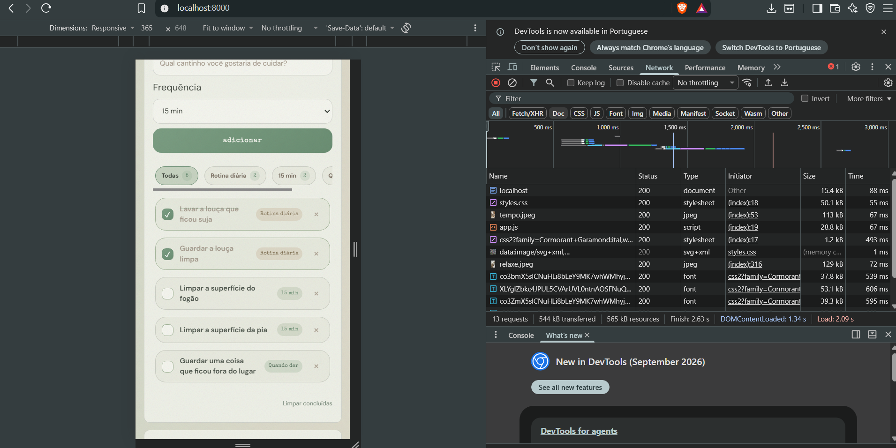

# CleanSpace 15 — Cuidado e Organização do Lar

Aplicação web desenvolvida para a atividade prática (Etapa 2) da disciplina **Desenvolvimento de Sistemas Web (EECP0036)** da **Universidade Federal do Maranhão (UFMA)**.

- **Discente:** Kauane Paixão Rocha
- **Matrícula:** 2026006160
- **Turma:** 24N12 · 2026.2
- **Docente:** Prof. Renan Sousa Freire
- **Tema:** 2. Lista de tarefas (focada em organização doméstica)
- **Trilha Escolhida:** Trilha C (sem API externa; lógica no cliente e dados persistidos em `localStorage`)

---

## 1. Sobre o Aplicativo

O **CleanSpace 15** é uma aplicação web minimalista e acolhedora voltada a ajudar pessoas com pouco tempo, rotinas sobrecarregadas ou dificuldade de iniciar tarefas a manterem a casa em ordem sem sobrecarga mental.

Em vez de incentivar faxinas pesadas de fim de semana ou cobranças punitivas, o aplicativo se apoia em dois modos complementares:
1. **Só 15 minutinhos (Modo Principal):** Permite focar em uma missão pequena por vez (divididas entre *Rotina diária*, *15 min* e *Quando der*) com o apoio de um cronômetro visual de 15 minutos que pode ser iniciado, pausado e reiniciado a qualquer momento.
2. **Tenho mais tempo (Planejador Semanal):** Distribuição opcional e flexível dos cuidados da casa ao longo dos dias da semana por cômodo (cozinha, quarto, banheiro, sala, armários/roupas, área externa).

### Funcionalidades Implementadas
- **Adição e exclusão de tarefas:** Entrada rápida de novas tarefas com validação contra campos vazios.
- **Categorização:** Filtros dinâmicos por categoria e por cômodo.
- **Cronômetro de foco de 15 minutos:** Temporizador interativo com prevenção de acionamento sem tarefas pendentes.
- **Persistência local (`localStorage`):** Todas as tarefas, estados de conclusão e registros de data são salvos no navegador, mantendo o estado entre recarregamentos da página.
- **Feedback emocional e acolhedor:** A interface reage dinamicamente conforme os cuidados são realizados, atualizando o humor da página e celebrando pequenas conquistas sem gerar culpa.

---

## 2. Tecnologias Utilizadas

O projeto foi construído estritamente com tecnologias web nativas, em conformidade com as diretrizes da disciplina:
- **HTML5 Semântico:** Estruturação acessível com uso de `<header>`, `<main>`, `<section>`, `<figure>`, `<figcaption>`, `<aside>`, `<footer>`, `<label>` devidamente vinculados a `<input>`/`<select>`, e atributos ARIA para leitores de tela.
- **CSS3 Responsivo:** Layout adaptável para dispositivos móveis, tablets e desktops (Grid e Flexbox), tipografia vintage editorial e paleta suave em tons de sálvia e linho (*Sage Green, Soft Sage, Light Sage, Sage Mist e Warm Linen*).
- **JavaScript Vanilla (ES6+):** Manipulação direta da DOM utilizando exclusivamente `document.createElement`, `textContent` e `append/replaceChildren`, **sem qualquer uso de `innerHTML`**, prevenindo vulnerabilidades de injeção de script (XSS).
- **Sem Frameworks:** Nenhum framework ou biblioteca externa (React, Vue, jQuery, Tailwind etc.) foi utilizado.

---

## 3. Como Rodar o Projeto Localmente

Como a aplicação é estática e utiliza a **Trilha C**, ela pode ser executada por qualquer servidor HTTP local.

### Opção 1: Via Python (Recomendado)
No terminal, dentro da pasta do projeto, execute:
```bash
python -m http.server 8000
```
Em seguida, abra o navegador e acerte o endereço:
[http://localhost:8000](http://localhost:8000)

### Opção 2: Extensão Live Server (VS Code)
1. Abra a pasta do projeto no VS Code.
2. Clique com o botão direito sobre o arquivo `index.html`.
3. Selecione a opção **"Open with Live Server"**.

---

## 4. Inspeção da Aba Rede (Network)

Em conformidade com a Seção 6 do edital para a **Trilha C**, foi realizada a captura da aba **Rede (Network)** do navegador (F12) durante a requisição que carrega a aplicação via servidor local:



### Explicação da Requisição:
> Ao recarregar a página no endereço `http://localhost:8000`, o navegador envia uma requisição HTTP via método **`GET`** para o arquivo principal `index.html`, obtendo a resposta com código de status **`200 OK`**. Como a aplicação pertence à **Trilha C (sem API externa)**, todas as requisições subsequentes carregam apenas os recursos estáticos locais (`styles.css`, `app.js` e as imagens `tempo.jpeg`, `organizacao.jpeg`, `relaxe.jpeg`), sendo toda a leitura e escrita de dados realizada em memória local através da API nativa do `localStorage`.

---

## 5. Declaração do Uso de Inteligência Artificial

Conforme exigido na Seção 8 das diretrizes da disciplina:

- **Ferramentas Utilizadas:** Google Gemini e assistente de IA.
- **O que foi solicitado:**
  1. Auxílio na arquitetura inicial da estrutura semântica em HTML5 e no mapeamento de acessibilidade (atributos WAI-ARIA).
  2. Sugestão e refinamento de paleta de cores no CSS baseada em tons suaves de sálvia/linho (*Sage Mist, Warm Linen*) e tipografia vintage editorial.
  3. Revisão do código JavaScript para garantia estrita do uso de `textContent` (evitando `innerHTML`) e boas práticas de validação de formulários nativos.
- **O que foi alterado e construído manualmente:**
  - Toda a lógica de estado do cronômetro de 15 minutos, controle de intervalos e persistência no `localStorage`.
  - O sistema de filtragem de tarefas, abas de categoria e seleção de cômodos.
  - A escrita de textos, tom de voz acolhedor e adequação do escopo ao contexto do projeto.

---

## 6. Estrutura de Arquivos

```text
├── index.html        # Estrutura HTML5 semântica e acessível
├── styles.css        # Folha de estilos completa e responsiva
├── app.js            # Lógica pura em JavaScript (DOM, timer, localStorage)
├── tempo.jpeg        # Imagem editorial (hero)
├── organizacao.jpeg  # Imagem editorial (planejamento)
├── relaxe.jpeg       # Imagem editorial (interlúdio de descanso)
├── rede.png          # Captura da aba Rede (Network) para avaliação
├── README.md         # Documentação e instruções de entrega
└── CONTEXTO.md       # Diretrizes conceituais do projeto
```
